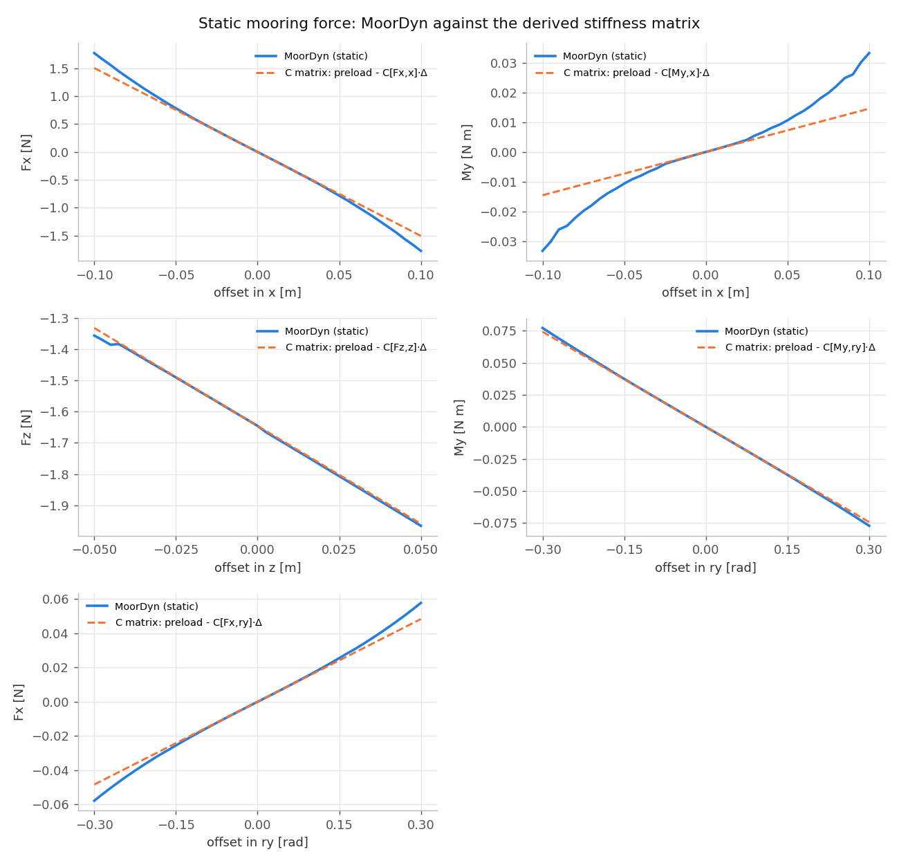
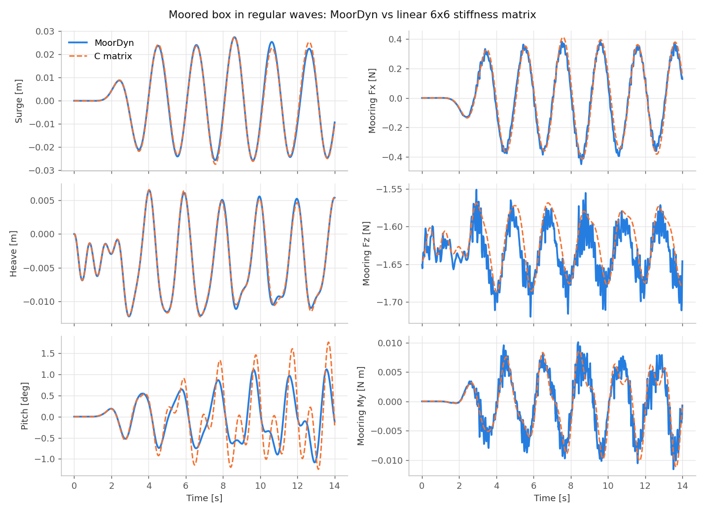
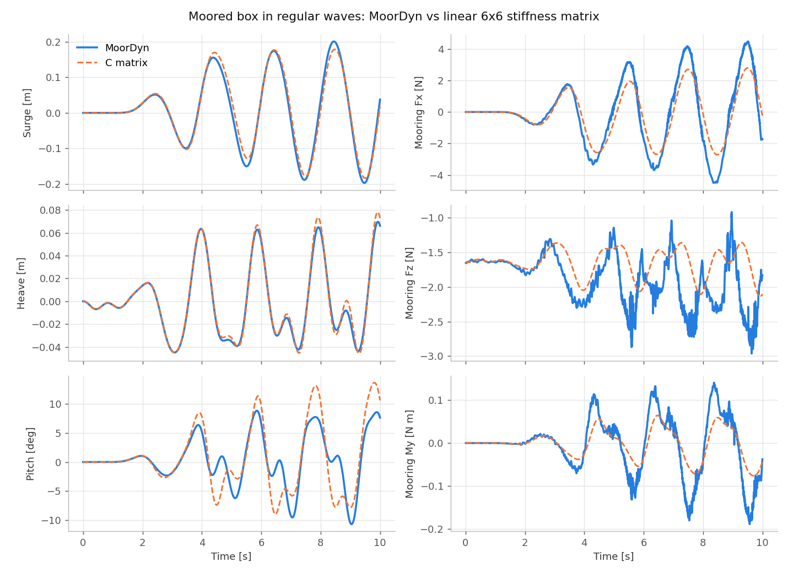

# Moored box with a linear 6x6 mooring stiffness matrix

This tutorial replaces the MoorDyn mooring of `tutorials/floatStepperWaveIsoFoam`
with a linear stiffness matrix **C**, derived from the same MoorDyn input file.
It then runs the CFD case once with each mooring model and compares them.

Use it for code-to-code validation. Potential-flow and BEM tools (WAMIT, Nemoh,
Capytaine, OrcaFlex linear moorings, ...) model a mooring as a 6x6 matrix. With
the same matrix in FoamWaveTank, any difference in the response comes from the
hydrodynamics, not from the mooring model. MoorDyn is not replaced: both
restraints are available, and you choose one per case.

## Running it

```sh
./Allrun                             # H = 0.02 m, T = 2 s, 14 s
./Allrun -height 0.12 -endTime 10    # the wave of tutorials/floatStepperWaveIsoFoam
./Allclean                           # removes everything Allrun made
```

`Allrun` makes two run folders from the template `case/`:

| Folder | Mooring | `constant/mooringRestraint` |
|---|---|---|
| `stiffnessMatrix/` | `floaterMotionRestraint mooringStiffnessMatrix` | copy of `mooringRestraint.stiffnessMatrix` |
| `moorDyn/` | `floaterMotionRestraint moorDynR2` (BODY coupling) | copy of `mooringRestraint.moorDyn` |

Allrun then:

1. derives C and the preload in `stiffnessMatrix/` with `moorDynStiffnessMatrix`
   (`constant/mooringStiffness`), and runs static sweeps in surge, heave and pitch
   (`constant/sweep_*.dat`). The sweeps are plotted to `staticLinearity.png`;
2. builds the mesh and waves in both folders and runs the two solvers at the
   same time, one core each (about 20 min for the default case);
3. compares the runs: `mooringComparison.png`, with a table of amplitudes, means
   and RMS differences in `log.compareMooringModels`.

Everything else is identical in the two folders: mesh, waves, body, solver
settings.

## The restraint

```
F = preload - C (xi - xi0) - B dxi/dt
xi = (x y z roll pitch yaw)    F = (Fx Fy Fz Mx My Mz)
```

- `xi` is the displacement of the reference point and the rotation of the body
  (rotation vector of Q Q0^T, which equals roll, pitch and yaw for small angles).
- `F` is the force and the moment about the current reference point, in global
  axes.
- Units are SI: N/m, N/rad, N m/m, N m/rad.
- `B` is an optional 6x6 damping matrix (`damping`). It is not used here.

```
mooring
{
    floaterMotionRestraint  mooringStiffnessMatrix;
    referencePoint  (0 0 -0.016);    // default: initial centre of rotation
    stiffness       ( (6 values) (6 values) ... );   // 6 rows, row i = F_i
    preload         (Fx Fy Fz Mx My Mz);             // default 0
    // damping      ( ... );                         // default 0
}
```

The library is `libmooringStiffnessMatrix` (`libs` in `system/controlDict`).

## How the C values were obtained

`moorDynStiffnessMatrix` linearises the MoorDyn model about the body's initial
position xi0 = (0, 0, -0.016, 0, 0, 0). This is `centreOfRotation` in
`0.orig/uniform/floaters`, and the same state that `moorDynR2` passes to MoorDyn.

1. Place the coupled body at xi0. MoorDyn's initial-condition solver relaxes the
   four lines to static equilibrium. Take one mooring time step with the body
   held still and read back the 6-component force on the body. This is the
   **preload** F0.
2. For each DoF j, repeat at xi0 + d e_j and xi0 - d e_j
   (d = 1 mm, or 1 mrad for rotations) and take central differences:

   ```
   C(:, j) = -( F(xi0 + d e_j) - F(xi0 - d e_j) ) / (2 d)
   ```

That is 13 MoorDyn static solutions, which take under a second. Entries below
1e-9 of the largest are set to zero. MoorDyn gives a `Coupled` body no mass,
volume or inertia, so F is the line force only; the CFD body carries its own
weight.

The command (from `Allrun`):

```sh
moorDynStiffnessMatrix -input Mooring/lines_v2_bodyC.txt \
    -position '(0 0 -0.016 0 0 0)' -delta 1e-3 -angleDelta 1e-3 \
    -output constant/mooringStiffness
```

The result for this mooring (four lines, EA = 29 N, 1.455 m unstretched,
fairleads at z = -0.061 m, anchors at (±1.385, ±0.423, -0.5)):

|    | x | y | z | rx | ry | rz |
|---|---:|---:|---:|---:|---:|---:|
| **Fx** | 15.076 | 0 | 0 | 0 | -0.1611 | 0 |
| **Fy** | 0 | 1.8353 | 0 | -0.0789 | 0 | 0 |
| **Fz** | 0 | 0 | 6.2763 | 0 | 0 | 0 |
| **Mx** | 0 | -0.0830 | 0 | 0.1776 | 0 | 0 |
| **My** | -0.1455 | 0 | 0 | 0 | 0.2474 | 0 |
| **Mz** | 0 | 0 | 0 | 0 | 0 | 0.2495 |

preload = (0, 0, -1.6454, 0, 0, 0) N, N m

Notes on the matrix:

- It is almost symmetric (max |C - C^T| / max |C| = 0.1 %). A preloaded mooring
  about a point need not be exactly symmetric.
- The heave term is 1.6 % of the hydrostatic heave stiffness of the box
  (rho g A_wp = 392 N/m). The surge term alone sets the surge natural period
  (about 2.9 s without added mass).
- Changing d between 1e-4 and 1e-2 changes the diagonal entries by less than
  0.4 %, except heave (3 %), and the small coupling entries by up to 5 %. The
  force is slightly nonlinear about xi0, and MoorDyn's relaxation tolerance
  (`threshIC` = 0.001) limits how accurately very small force changes can be
  resolved.

### Static check: where the linear model holds

`moorDynStiffnessMatrix ... -sweep '(dof amplitude n)'` writes the MoorDyn force
and the linear prediction for 2n+1 offsets of one DoF.



Error of the diagonal term, relative to the largest |F - preload| in the sweep:

| Offset | surge Fx | heave Fz | pitch My |
|---|---:|---:|---:|
| 2.5 cm / 0.15 rad | 0.2 % | 1.3 % | 0.4 % |
| 5 cm / 0.30 rad | 1.7 % | 2.0 % | 3.8 % |
| 10 cm | 15 % | -- | -- |

The lines stiffen in surge beyond about 5 cm. The surge-pitch couplings
(My against x, Fx against ry) turn nonlinear earlier than the diagonal terms.

## CFD comparison with MoorDyn

floatStepperWaveIsoFoam, OpenFOAM v2506, serial. Amplitudes are half of the
peak-to-peak value over the last two wave periods.

### H = 0.02 m (default): motions inside the linear range



| t = 10-14 s | MoorDyn | C matrix | |
|---|---:|---:|---:|
| surge amplitude | 24.98 mm | 25.09 mm | +0.5 % |
| heave amplitude | 8.20 mm | 8.41 mm | +2.6 % |
| mooring Fx amplitude | 0.386 N | 0.381 N | -1.3 % |
| mooring My amplitude | 0.0097 N m | 0.0088 N m | -10 % (line noise in MoorDyn) |
| pitch amplitude | 1.10 deg | 1.50 deg | +37 % |

Surge, heave and the mooring force agree. Pitch does not, although the mooring
moment does. Pitch is lightly damped, and the drag and inertia of the MoorDyn
lines damp it; a static stiffness matrix has no damping. To compare pitch, add a
`damping` matrix, or compare with a code that also leaves line damping out.

### H = 0.12 m (`-height 0.12 -endTime 10`): beyond the linear range



The runs are identical until about t = 3.5 s. Then surge reaches ±0.2 m,
twice the offset at which the static error is already 15 %. MoorDyn's lines
stiffen: the Fx amplitude is 4.5 N against 2.75 N, and Fz and My show
line-dynamics spikes. Surge and heave stay close (RMS difference 7 % and 6 % of
the amplitude); pitch and the mooring force do not. Use a stiffness matrix only
where the motions stay within the static range above.

## Using a C matrix from another code

Write `stiffnessMatrix/constant/mooringStiffness` (or the template
`case/constant/mooringRestraint.stiffnessMatrix`) by hand with your
`referencePoint`, `stiffness` and `preload`, then skip step 1 of `Allrun`.
Make sure C refers to the same point, and uses the same sign convention
(F = -C xi, so C is positive definite for a restoring mooring) and the same
angle units (rad) as the other code.

## Files

| File | Content |
|---|---|
| `Allrun`, `Allclean` | run / clean the whole comparison |
| `case/` | case template; `constant/mooringRestraint.*` are the two mooring models |
| `case/Mooring/lines_v2_bodyC.txt` | MoorDyn v2 input (Wu et al. 2019 box), the source of C |
| `scripts/plotStaticLinearity.py` | plots the static sweeps |
| `scripts/compareMooringModels.py` | compares two runs: motions, mooring force, statistics |
| `validation/` | reference plots shown above and the statistics tables (`log.compareMooringModels_H*`) |
